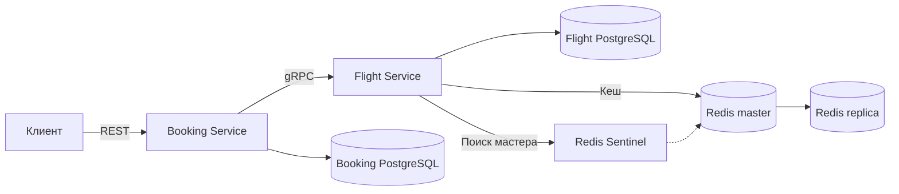

# Flight Booking

Два микросервиса на Python 3.12. Booking Service принимает REST-запросы через FastAPI. Flight Service выполняет операции с рейсами по gRPC. У каждого сервиса своя PostgreSQL. Flight Service кеширует ответы в Redis и узнаёт адрес мастера у Sentinel.



Запуск из корня проекта.

```powershell
docker compose up
```

В старом CLI используется `docker-compose up`. Docker генерирует Python-код из [flight.proto](proto/flight.proto) командой `grpc_tools.protoc`. Оба сервиса автоматически применяют версионированные SQL-миграции при запуске. Таблица `schema_migrations` запоминает применённые файлы.

- [Swagger UI](http://localhost:8000/docs)
- [Проверка готовности Booking Service](http://localhost:8000/health)
- gRPC доступен с хоста на `127.0.0.1:50051`

## Быстрая проверка

На тестовых данных есть два рейса SVO → LED на 1 апреля 2026 года. У первого 120 мест, у второго одно. Есть обратный рейс и отменённый рейс. Поиск показывает только `SCHEDULED`. Дата опциональна и интерпретируется в UTC. Статусы тестовых рейсов заданы миграцией.

```powershell
$base = 'http://localhost:8000'
$flights = Invoke-RestMethod "$base/flights?origin=SVO&destination=LED&date=2026-04-01"
$booking = Invoke-RestMethod -Method Post -Uri "$base/bookings" -ContentType 'application/json' -Body (@{
    user_id = 'student'
    flight_id = $flights[0].id
    passenger_name = 'Ivan Ivanov'
    passenger_email = 'ivan@example.com'
    seat_count = 2
} | ConvertTo-Json)
$booking
Invoke-RestMethod "$base/bookings/$($booking.id)"
Invoke-RestMethod "$base/bookings?user_id=student"
Invoke-RestMethod -Method Post -Uri "$base/bookings/$($booking.id)/cancel"
```

| REST | Результат |
| --- | --- |
| `GET /flights?origin=SVO&destination=LED&date=2026-04-01` | Массив рейсов |
| `GET /flights/{id}` | Рейс или 404 |
| `POST /bookings` | Бронирование `CONFIRMED`, HTTP 201 |
| `GET /bookings/{id}` | Бронирование или 404 |
| `POST /bookings/{id}/cancel` | Бронирование `CANCELLED` |
| `GET /bookings?user_id=student` | Массив бронирований пользователя |

Для расчётов используются целые копейки. В REST `price` и `total_price` передаются десятичными строками в рублях, например `"15000.00"`. Нехватка мест возвращает HTTP 409, отсутствие сущности 404, открытый Circuit Breaker 503. Ошибки Flight Service включают поле `grpc_code`.

## Где реализованы требования

| Пункт | Реализация |
| --- | --- |
| 1 | [Контракт](proto/flight.proto) с `Timestamp`, enum и описанием ошибок. Python-клиент и серверные интерфейсы генерируются при сборке. |
| 2 | [ER-диаграмма и объяснение 3NF](docs/er.md). Ограничения задаются в SQL. |
| 3 | [Docker Compose](docker-compose.yml) запускает REST, gRPC и две PostgreSQL. [Мигратор](common/migrations.py) применяет SQL на старте. |
| 4 | [Booking Service](booking_service/app.py) выполняет `GetFlight → ReserveSeats → INSERT`. При отмене вызывает `ReleaseReservation` по `booking_id`. |
| 5 | [Flight Service](flight_service/server.py) блокирует строку рейса через `SELECT FOR UPDATE` и меняет остаток и резерв в одной транзакции. Booking хранит намерения в PostgreSQL и доводит прерванные операции после восстановления связи. |
| 6 | API-ключ из `API_KEY` передаётся в metadata `x-api-key`. Серверный interceptor проверяет каждый метод и возвращает `UNAUTHENTICATED` при неверных credentials. |
| 7 | [Cache-Aside](flight_service/cache.py) кеширует рейс и поиск. `ReserveSeats`, `ReleaseReservation` и `UpdateFlight` сбрасывают ключи после изменения. |
| 8 | gRPC interceptor делает до трёх попыток для `UNAVAILABLE` и `DEADLINE_EXCEEDED` с паузами 100 и 200 мс. Повтор `ReserveSeats` сохраняет тот же `booking_id`. |
| 9 | Redis мастер, реплика и Sentinel. Клиент обнаруживает текущего мастера через Sentinel. |
| 10 | [Circuit Breaker](booking_service/resilience.py) ограничивает gRPC-вызовы при серии сбоев. В `HALF_OPEN` проходит одна проба. Переходы видны в логах. |

Flight Service резервирует или возвращает места одной локальной транзакцией. Booking Service записывает итоговое бронирование только после успешного `ReserveSeats`. Если процесс прервётся между БД, фоновая обработка сохранённого намерения возвращает места для несостоявшегося бронирования или завершает уже начатую отмену. Во время недоступности одного сервиса согласованность между БД восстанавливается после его возврата.

`UpdateFlight` служит для изменения цены или статуса. Это gRPC-метод с тем же API-ключом. Он инвалидирует ключ рейса и результаты поиска по маршруту с датой и без неё.

## Кеш и отказоустойчивость

`flight:{id}` и `search:{origin}:{destination}:{date|all}` живут семь минут по умолчанию. При отсутствии ключа Flight Service читает PostgreSQL и записывает ответ в Redis с TTL. При недоступности Redis чтение продолжает работать через PostgreSQL. Flight Service помечает значения версии локальным токеном, поэтому даже старая копия ключа на повышенной реплике игнорируется после изменения. Эта схема рассчитана на один экземпляр Flight Service в Compose. Два одинаковых запроса подряд показывают `cache miss` и `cache hit` в логах Flight Service.

```powershell
docker compose logs --tail 30 flight-service
docker compose exec redis-sentinel redis-cli -p 26379 SENTINEL get-master-addr-by-name flight-redis
```

Для проверки failover узнайте имя текущего мастера командой выше. В начальной конфигурации это `redis-master`. Остановите его командой `docker compose stop redis-master`. Через несколько секунд Sentinel должен указать на `redis-replica`. Повторите поиск и верните остановленный узел командой `docker compose start redis-master`. Конфигурация с одним Sentinel соответствует заданию. Для самого Sentinel второй экземпляр в этой схеме отсутствует. [Документация Redis Sentinel](https://redis.io/docs/latest/operate/oss_and_stack/management/sentinel/)

Для проверки Circuit Breaker остановите `flight-service` и выполните несколько запросов к `/flights`. После пяти неудачных gRPC-вызовов за 30 секунд запросы быстро возвращают 503. Запустите сервис командой `docker compose start flight-service`. После 15 секунд в `OPEN` следующий вызов станет пробным. В логах `docker compose logs booking-service` видны повторы и переходы `CLOSED → OPEN → HALF_OPEN → CLOSED`.

| Переменная Compose | По умолчанию |
| --- | --- |
| `API_KEY` | `local-flight-api-key` для локального запуска |
| `CACHE_TTL_SECONDS` | 420, допустимо от 300 до 600 |
| `FLIGHT_RPC_TIMEOUT_SECONDS` | 1 секунда на попытку |
| `CIRCUIT_FAILURE_THRESHOLD` | 5 завершившихся ошибкой gRPC-вызовов |
| `CIRCUIT_WINDOW_SECONDS` | 30 секунд |
| `CIRCUIT_OPEN_SECONDS` | 15 секунд |

Настройки можно задать через окружение или локальный `.env` перед запуском Compose. Оба сервиса получают одинаковый API-ключ. Конфигурация рассчитана на локальный учебный запуск. PostgreSQL и Redis доступны только в сети Compose.
