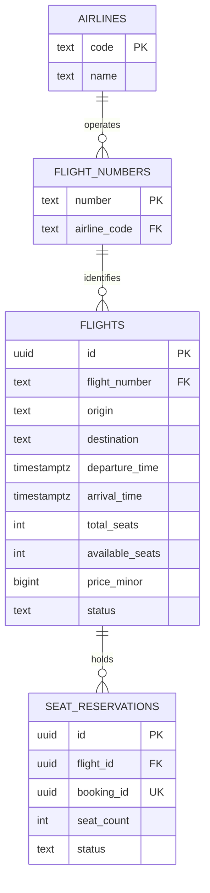
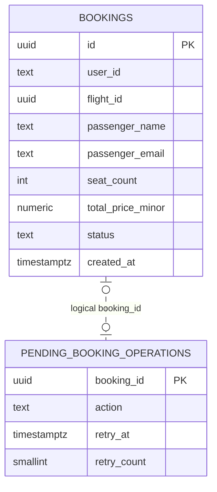

# ER-диаграмма

У Flight Service и Booking Service разные экземпляры PostgreSQL. Внешние ключи связывают таблицы внутри одной БД.

## Flight DB

Уникальный индекс по номеру рейса и дате вылета в UTC запрещает два экземпляра одного рейса за сутки. `CHECK` задаёт формат IATA-кодов, отличные аэропорты вылета и прилёта, прилёт после вылета, положительные вместимость и цену, а также остаток в диапазоне от нуля до вместимости. Статусы ограничены допустимыми значениями.

## Booking DB

Связь с журналом логическая. Запись для возврата мест может существовать до появления бронирования. `bookings.flight_id` и `seat_reservations.booking_id` тоже связываются через API. Ограничение `UNIQUE (booking_id)` на стороне Flight Service гарантирует максимум один резерв на бронирование. Booking Service создаёт подтверждённое бронирование только после успешного резерва.

Схема в 3NF. Название авиакомпании зависит от её кода, поэтому хранится в `airlines`. Принадлежность номера авиакомпании хранится в `flight_numbers`. Остаток мест относится к конкретному вылету и меняется транзакционно. Имя и email описывают пассажира именно этого бронирования. Цена рейса может измениться, а `total_price_minor` фиксирует стоимость при покупке и остаётся прежней.
